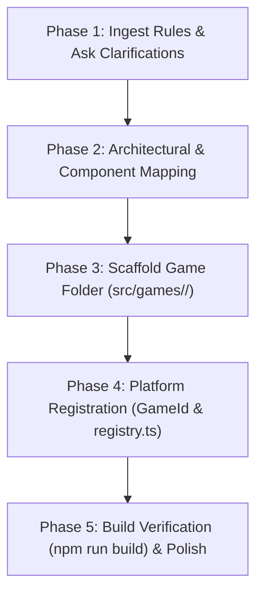

# TableSkull Game Creator Skill

This skill guides the end-to-end creation of new tabletop games for the **TableSkull** platform. It provides a standardized pipeline: from ingesting raw rules and asking clarification questions to scaffolding components, implementing bot AI, wiring sound cues, and registering the game seamlessly into the platform.

---

## 1. Prerequisites & Architectural Context

Before writing any code, familiarize yourself with TableSkull's plugin architecture:
- **Contract & Architecture Reference**: [reference/architecture.md](reference/architecture.md)
- **Component & Asset Catalog**: [reference/component-catalog.md](reference/component-catalog.md)
- **Boilerplate Code Templates**: [reference/templates.md](reference/templates.md)

### Key Rules of TableSkull Architecture
1. **Never edit platform shell components** (`App.tsx`, `GameArena.tsx`, `CreateRoomModal.tsx`, `RoomSettingsModal.tsx`, `PreGameLobby.tsx`, `RulesModal.tsx`) when adding a new game.
2. Every game is self-contained inside `src/games/<game-id>/`.
3. The game connects to the platform solely via `GameManifest` registered in `src/games/registry.ts` and `GameId` in `src/types/index.ts`.
4. All games follow the authentic **1930s Fleischer / Cuphead rubber-hose aesthetic** (ink outlines, aged parchment, cel-card drop-shadows, brass stopwatches, and mechanical click/bell/trumpet audio).

---

## 2. The 5-Phase Creation Pipeline



---

### Phase 1: Rule Ingestion & Interactive Discovery

When a user presents rules or a game concept, analyze them against these key mechanical pillars:

| Mechanical Pillar | Questions to Resolve | Options in TableSkull |
| :--- | :--- | :--- |
| **Pacing / Timing** | Is the match governed by a countdown clock or turns? | Real-time countdown (`hasRoundTimer: true`) vs. Turn-based / Hands (`hasRoundTimer: false`) |
| **Score Visibility** | Are scores public continuously or secret until round end? | Live top scoreboard (`hideContinuousScoreboard: false`) vs. End-of-round Revelation / Ledger (`hideContinuousScoreboard: true`) |
| **Player Count** | How many contenders can play simultaneously? | Typically 2–4 or 2–8 contenders |
| **Core Game Objects** | What physical board game pieces are involved? | Cards (suits/roles), Dice (faces/rolling cups), Letter grid (coordinates/swipes), Tactical board (tiles/tokens) |
| **Bot AI Behavior** | How should automated contenders play? | Heuristic bot, bluff simulator, ducking/trumps AI, or word-finder solver |
| **Custom Settings** | Does the room need custom settings before starting? | Board sizes, languages/dictionaries, rounds count, or difficulty modes |

#### Interactive Clarification Protocol
If any critical mechanic is underspecified, **do not make arbitrary assumptions**. Proactively ask the user targeted questions using the `ask_question` tool.

**Example questions to ask:**
- *"Should the match use a real-time countdown clock (e.g. 2 minutes) or turn-based rounds?"*
- *"Should opponents' current scores be visible in real time during the match, or kept hidden until a final revelation screen?"*
- *"Would you like custom room setup options (like board size or difficulty), or should it use standard defaults?"*

---

### Phase 2: Architectural & Component Mapping

Match the game's mechanics to existing TableSkull patterns to maximize component reuse:

1. **Card / Trick-Taking Games**:
   - Reference: `src/games/midnight-alley/`
   - Reusable elements: SVG playing card views (`MidnightCards.tsx`), suit badges, bidding stepper, hand cycles, card fan layout.
2. **Grid / Word / Puzzle Games**:
   - Reference: `src/games/bonegle/` & `src/games/vortilex/`
   - Reusable elements: SVG drag/swipe trail engine (`BonegleEngine.tsx`), 3D wooden letter dice, Trie lookup, word bank receipt, revelation screen.
3. **Dice / Bluffing / Bidding Games**:
   - Reference: `src/games/skull-bones/`
   - Reusable elements: Leather dice cup rattle, hidden dice tray, bid increment counter, bluff challenge showdown.
4. **Board / Tactical Games**:
   - Reference: `src/components/GenericGameEngine.tsx`
   - Reusable elements: Woodcut checkered board mat, cell selection, piece placement.
5. **Soundstage Audio**:
   - Wire standard sounds using `soundstage` from `src/utils/audio.ts` (`playTap`, `playCardPlay`, `playRoundBell`, `playScoreTrumpet`, `playTimerWarning`, `playRoundEnd`).

---

### Phase 3: Scaffolding the Game Module

Create the directory `src/games/<game-id>/` with the standard 7-file structure:

```
src/games/<game-id>/
├── types.ts              # Local state, actions, piece models
├── <game>Logic.ts        # Concrete class extending AbstractGameEngine
├── <Game>Components.tsx  # Interactive UI subcomponents
├── <Game>Engine.tsx      # Main game canvas implementing BaseGameEngineProps
├── <Game>Rules.tsx       # Mafia Codex-style rules for RulesModal
├── <Game>Settings.tsx    # (Optional) Custom form for room modals
├── manifest.tsx          # GameManifest declaration
└── index.ts              # Barrel exports
```

#### File Implementation Requirements

1. **`types.ts`**:
   - Define `GameState`, `GameAction`, and any domain entities.
   - Props interface: `export interface <Game>EngineProps extends BaseGameEngineProps { ... }`.
2. **`<game>Logic.ts`**:
   - Must export class `<Game>GameLogic extends AbstractGameEngine<GameState, GameAction>`.
   - Implement `initialize`, `processAction`, `calculateScores`, and `checkGameOver`.
   - Implement bot AI helper functions for automated players.
3. **`<Game>Components.tsx`**:
   - Subcomponents styled with `.cel-card`, `.btn-cel`, and TableSkull design tokens.
4. **`<Game>Engine.tsx`**:
   - Main component taking `BaseGameEngineProps`.
   - Triggers `onPlayerScore(playerId, pts)` when points are earned.
   - Triggers `onActionNotification(text)` to broadcast moves to the match chat feed.
   - Triggers `onMatchResolved(winner, reason)` when victory condition is met.
5. **`<Game>Rules.tsx`**:
   - Styled with `.codex-header`, `.codex-section`, `.codex-scoring-grid`, and `.score-rule-badge`.
6. **`<Game>Settings.tsx`**:
   - Implements `React.FC<GameSettingsFormProps>`.
   - Modifies `settings` via `onUpdateSetting(key, value)`.
7. **`manifest.tsx`**:
   - Declares and exports `<game>Manifest: GameManifest`.
   - Configures `hasRoundTimer`, `hideContinuousScoreboard`, `formatBadge`, `arenaLayoutClass`, `engine`, `rulesComponent`, `settingsComponent`, and `lobbyMetaChips`.
8. **`index.ts`**:
   - Re-exports everything from the folder.

*(See [reference/templates.md](reference/templates.md) for complete copy-paste boilerplate code).*

---

### Phase 4: Platform Registration (Zero-Friction Integration)

Once the game folder is created, integrate it into the platform with **only two lines of code**:

1. **Register the Game ID** in `src/types/index.ts`:
   ```typescript
   export type GameId = 'bonegle' | 'midnight-alley' | 'vortilex' | 'skull-bones' | 'royal-checkers' | 'mystery-manor' | '<game-id>';
   ```

2. **Register the Manifest** in `src/games/registry.ts`:
   ```typescript
   import { <game>Manifest } from './<game-id>';

   export const GAME_REGISTRY: Record<GameId, GameManifest> = {
     // ... other games
     '<game-id>': <game>Manifest,
   };
   ```

3. Re-export in `src/games/index.ts`:
   ```typescript
   export * from './<game-id>';
   ```

That is all! The platform shell will immediately and dynamically handle:
- Room creation game selection card
- Room browser filter tabs
- Pre-game lobby details, chips, and invite links
- In-game rules modal codex
- Custom settings in room creation and room settings modals
- Game canvas mounting inside the arena iframe
- Match victory and rematch flows

---

### Phase 5: Verification & Quality Assurance

1. **TypeScript & Bundling**:
   Run the project build:
   ```bash
   npm run build
   ```
   Ensure **0 errors** and clean minification.
2. **Visual & Styling Check**:
   - Verify that 1930s Fleischer aesthetics are preserved (ink borders, typography, cel-shadows).
   - Ensure the canvas layout fits responsively inside `GameStageFrame`.
3. **Soundstage & Interactions**:
   - Check that interactive clicks trigger `soundstage.playTap()`.
   - Check that scoring triggers `soundstage.playScoreTrumpet()`.
   - Check that round/turn starts trigger bells or card deals.
4. **Multiplayer & Bot Simulation**:
   - Ensure bot players take turns or generate simulated actions so solo testing works seamlessly.
