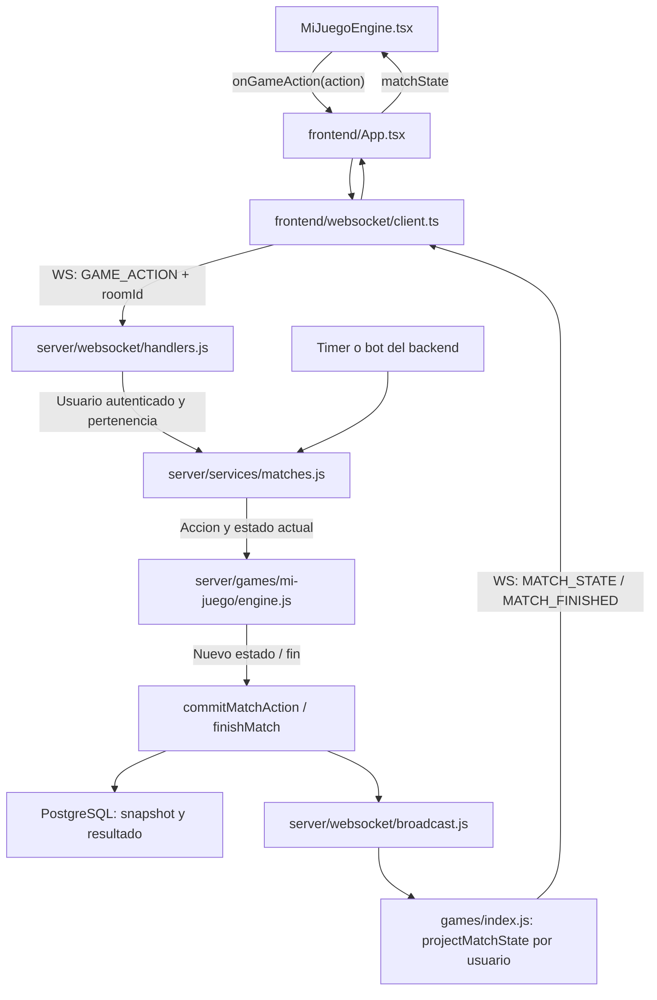

# Anadir un Juego

Un juego necesita tres piezas: **contratos compartidos**, **motor autoritativo de backend** e **interfaz React**. El manifiesto registra la interfaz; no registra automaticamente las reglas en el backend.

Esta guia describe la estructura actual. Consulta tambien [la arquitectura](ARQUITECTURA_AUTORITATIVA.md) y [el contrato de juego](GAME_ARCHITECTURE_CONTRACT.md).

## Donde Va Cada Cosa

```text
src/
  shared/types/
    index.ts                         GameId y modelos de plataforma
    network.ts                       GameAction, MatchState y NetworkEvent
    mi-juego.ts                      Datos de piezas y estado visible (si hace falta)
  server/games/mi-juego/
    engine.js                        Estado inicial, acciones y transiciones
    rules.js                         Reglas puras y puntuacion (si hace falta)
    bot.js                           Seleccion de acciones de bots (si hace falta)
    projection.js                    Estado visible por usuario (si hace falta)
  frontend/games/mi-juego/
    MiJuegoEngine.tsx                Renderiza matchState y envia acciones
    MiJuegoComponents.tsx            Componentes propios (si hace falta)
    MiJuegoRules.tsx                 Reglas para el jugador
    MiJuegoSettings.tsx              Ajustes del lobby (si hace falta)
    manifest.tsx                    GameManifest
    index.ts                         Exporta el manifiesto y componentes
tests/
  games.test.js                      Pruebas del motor
  backend.test.js                    Integracion HTTP, WebSocket y persistencia
```

No crees archivos vacios para completar el arbol. El backend usa JavaScript ESM; frontend y contratos usan TypeScript. Los modulos de `shared` no deben importar React, `window`, APIs de Node ni modulos de `frontend` o `server`.

Los avatares de perfil se guardan solo en `src/frontend/assets/avatars` y se registran en [avatars.tsx](../src/frontend/utils/avatars.tsx). Importa las imagenes propias del juego desde el frontend; utiliza `public` solo cuando necesites una URL estatica. Los diccionarios de Bonegle estan en `public/dict` y el backend los lee usando `ROOT_DIR`, no desde el navegador.

## Como Se Conecta



La sesion y el socket ya existen antes de entrar al juego. Crear o unirse a una sala e iniciar la partida son llamadas HTTP; al entrar en la sala, el cliente envia `SUBSCRIBE_ROOM` por el mismo socket. No crees otro socket, servidor o tabla de usuarios por juego.

## 1. Definir Contratos

En [src/shared/types/index.ts](../src/shared/types/index.ts), anade el ID a `GameId`. En [src/shared/types/network.ts](../src/shared/types/network.ts):

- Anade el estado visible a la union `MatchState`, discriminado por `gameId: 'mi-juego'`.
- Anade las acciones a `GameAction`, con nombres y payloads propios del juego.
- Extiende `NetworkEvent` solo si necesitas feedback que no cabe en el estado general.

El cliente envia intenciones, no resultados: por ejemplo, `{ type: 'MI_JUEGO_PLAY', pieceId }`, nunca puntos o un ganador. La identidad del actor procede de la sesion del servidor, no de un `playerId` enviado por el cliente. Los tipos TS no sustituyen la validacion runtime de mensajes JSON.

Separa el estado interno del estado enviado: mazos, manos ajenas, semillas privadas o decisiones pendientes no deben estar en la proyeccion publica.

## 2. Implementar el Motor

En `src/server/games/mi-juego/engine.js`, implementa:

| Operacion | Responsabilidad |
| --- | --- |
| Estado inicial | Recibe sala y matchId; crea participantes, fases, tablero o reparto y deadlines |
| Aplicar accion | Valida fase, actor, turno, propiedad de piezas y datos; modifica solo acciones aceptadas |
| Resolver | Calcula puntos y ganador; define la fase terminal y finishedAt |
| Proyectar | Devuelve solo lo que puede ver el usuario, incluidas las partes permitidas del historial |
| Retirar jugador | Limpia sus datos y define que ocurre con el turno o ronda |
| Accion automatica | Elige acciones legales para bots o expiracion de plazo |

Las reglas no abren sockets ni escriben SQL. El servicio de partidas coordina timers, persistencia y difusion. Una accion rechazada no debe dejar un estado parcialmente modificado. El cliente puede hacer validaciones visuales, pero el servidor siempre vuelve a comprobarlas.

## 3. Conectar el Backend

Actualmente hay ramas explicitas para Bonegle y Midnight Alley. Amplia cada una para el juego nuevo; no dejes que el ID caiga en un `else` de Midnight Alley.

| Archivo existente | Cambio necesario |
| --- | --- |
| [games/index.js](../src/server/games/index.js) | Dispatch de `createMatchState`, `removePlayerFromMatch`, `matchScores` y `projectMatchState` |
| [services/matches.js](../src/server/services/matches.js) | Dispatch de `applyMatchAction`, creacion de deadline, `handleMatchDeadline` y `scheduleMatch`; conectar bots y finalizacion |
| [services/roomLifecycle.js](../src/server/services/roomLifecycle.js) | Retirada, quorum, walkover, fase terminal y deadlines al salir un jugador |
| [routes/rooms.js](../src/server/routes/rooms.js) | Admitir gameId al crear sala, min/max jugadores y validar ajustes en creacion/actualizacion |
| [config.js](../src/server/config.js) | Valores por defecto si hay nuevos ajustes comunes |
| [db/schema.js](../src/server/db/schema.js) | Admitir gameId en las restricciones de rooms y matches para instalaciones nuevas |

Reutiliza `commitMatchAction` para acciones aceptadas y `finishMatch` para resultados. No implementes otro ciclo de guardado o timers en el componente React.

[websocket/handlers.js](../src/server/websocket/handlers.js) ya entrega `GAME_ACTION` al servicio: normalmente no necesita una rama por juego. [websocket/broadcast.js](../src/server/websocket/broadcast.js) proyecta y distribuye el estado. Si anades feedback privado, actualiza emision, `NetworkEvent` y consumo en el cliente; no lo difundas a toda la sala.

### Bases de Datos Existentes

Cambiar `CREATE TABLE IF NOT EXISTS` **no actualiza las restricciones de tablas existentes**. Antes del despliegue, consulta los nombres reales:

```sql
SELECT conrelid::regclass AS table_name, conname, pg_get_constraintdef(oid)
FROM pg_constraint
WHERE contype = 'c'
  AND conrelid IN ('rooms'::regclass, 'matches'::regclass);
```

Prepara una migracion transaccional que sustituya los dos CHECK de `game_id`, conserve los IDs anteriores y anada `'mi-juego'`. Aplica la migracion tanto a la instalacion existente como al esquema de nuevas instalaciones. No borres tablas ni datos para registrar un juego.

## 4. Implementar y Registrar la UI

`MiJuegoEngine.tsx` recibe [BaseGameEngineProps](../src/frontend/types/game.ts). Debe leer `matchState`, comprobar su `gameId` y enviar `onGameAction(action)`. Solo mantiene estado local de presentacion: seleccion, animacion, orden visual o modales.

No inicialices partidas, repartas cartas, ejecutes bots ni decidas puntuaciones con `onPlayerScore` o victorias con `onMatchResolved`: esos callbacks son compatibilidad historica, no el flujo autoritativo. `AbstractGameEngine` sigue declarado, pero no es un requisito de los motores actuales.

Configura `manifest.tsx` con ID, definicion, `engine`, reglas y ajustes opcionales. Usa `hasRoundTimer`, `hideContinuousScoreboard`, `formatBadge` y `lobbyMetaChips` segun el juego. **Min/max jugadores deben coincidir con la validacion del backend.**

Registra el manifiesto en [frontend/games/registry.ts](../src/frontend/games/registry.ts) y exportalo desde [frontend/games/index.ts](../src/frontend/games/index.ts).

El catalogo, los ajustes y las reglas se montan mediante el manifiesto. Reutiliza el shell, pero revisa [frontend/App.tsx](../src/frontend/App.tsx): la extraccion de puntuaciones en `MATCH_FINISHED` distingue actualmente Bonegle de `cumulativeScores`. Si el nuevo estado no usa ese formato, anade su conversion a jugadores/podio. Revisa tambien cualquier feedback privado nuevo. No es una integracion de solo dos lineas.

El escenario es un iframe con portal React. Usa `ownerDocument` y su ventana para eventos y geometria del puntero. Conserva el estilo existente y reutiliza `soundstage` y `AvatarIcon`; no reinicies el estado del servidor desde efectos de React.

## 5. Verificar

```bash
npm run build
npm run test:server
```

Anade pruebas del juego en [tests/games.test.js](../tests/games.test.js): acciones legales e ilegales, turno, puntuacion, fin, bots, deadlines y retirada de jugadores. Verifica la proyeccion sin manos o datos privados de terceros.

Extiende [tests/backend.test.js](../tests/backend.test.js) para crear una sala del nuevo ID, suscribirse, iniciar, enviar acciones y terminar. Incluye quorum, rematch y cierre sin humanos. La prueba con PostgreSQL requiere `TABLEBONES_TEST_DATABASE_URL`, permisos para crear esquemas y la migracion de CHECK aplicada; el test usa un esquema aislado y lo elimina.

Prueba tambien sockets no autorizados, mensajes malformados y aislamiento entre salas. Sin una base disponible, informa que la persistencia no se verifico: una compilacion correcta no demuestra que el servidor acepte el gameId. Respeta las restricciones de pruebas manuales del usuario.