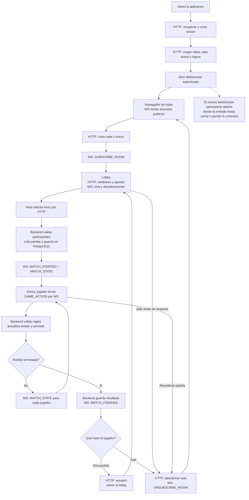

# Contexto de la Arquitectura Autoritativa

El cambio principal es que **el navegador solicita acciones y el backend decide el estado de la partida**. React ya no determina puntuaciones, ganadores ni avances de juego.

Esta guia explica el recorrido de una sesion y la separacion de responsabilidades. El detalle de interfaces y eventos esta en [el contrato tecnico](GAME_ARCHITECTURE_CONTRACT.md).

## Flujo Completo

**Crear una sala no crea una partida.** La sala existe primero como lobby; la partida se crea cuando el host solicita el inicio.



El diagrama muestra el recorrido normal. Si al entrar se recupera una sala activa anterior, la aplicacion vuelve a su lobby o arena y se suscribe a ella. Los timers y bots tambien pueden avanzar el juego sin una accion del cliente.

### HTTP y WebSocket

| Canal | Funcion |
| --- | --- |
| HTTP | Sesion, consultas y operaciones de sala: crear, unirse, readiness, ajustes, iniciar, rematch y salir |
| WebSocket | Anuncios publicos, suscripcion a sala, chat, acciones de juego y estado en tiempo real |

El WebSocket se abre tras cargar la sesion y los datos iniciales. **No se abre otro al crear una sala o iniciar una partida.** Al salir de la sala se cancela la suscripcion, no la conexion.

El backend comprueba la pertenencia antes de aceptar una suscripcion. Los estados de partida y el chat se envian a suscriptores; los anuncios de salas publicas tambien llegan a clientes autenticados fuera de esas salas.

En desarrollo, Vite redirige HTTP y WebSocket al backend. Bajo `/tablebones/`, el cliente usa `/tablebones/api` y `/tablebones/tablebones-ws`. Con HTTPS, el socket utiliza `wss:`.

## Responsabilidades

| Capa | Responsabilidad |
| --- | --- |
| React | Renderizar estado, recoger interacciones, reproducir audio y enviar acciones |
| Backend Node.js | Autenticar, gestionar salas, validar reglas, ejecutar bots y timers, calcular puntos y ganador |
| PostgreSQL | Persistir usuarios, sesiones, salas, participantes, chat, snapshots de partidas, resultados y logros |

El estado activo vive en memoria del backend y se guarda en PostgreSQL despues de las acciones aceptadas. Al terminar, se persisten resultado, puntuaciones y estadisticas, y se cancela el timer de la partida.

## Logica de Juegos

### Por Que Esta en el Backend

Las reglas decisivas estan en [src/server/games](../src/server/games) porque el navegador puede manipularse o desconectarse. El servidor valida cada accion, mantiene una referencia comun para los jugadores y conserva informacion privada, como las manos de Midnight Alley.

[src/frontend/games](../src/frontend/games) contiene la interfaz de cada juego: manifiestos, componentes, instrucciones, tipos e interacciones. Puede anticipar feedback visual, pero no decidir el resultado real.

| Juego | Cliente | Servidor |
| --- | --- | --- |
| Bonegle | Recoge el trazo y envia `SUBMIT_WORD` con palabra y ruta | Genera tablero, valida ruta y diccionario, detecta repetidos y puntua al vencer el plazo |
| Midnight Alley | Presenta la mano y envia apuestas, cartas y solicitudes de avance | Reparte, valida jugadas, resuelve bazas y rondas, calcula puntos y ganador |

Bonegle devuelve `BONEGLE_WORD_RESULT` solo al remitente (`valid`, `duplicate`, `invalid`). Midnight Alley proyecta el estado con `projectMatchState`: cada jugador recibe su propia mano y el numero de cartas de los demas.

### Helpers y Organizacion

[midnightAlleyLogic.ts](../src/frontend/games/midnight-alley/midnightAlleyLogic.ts) conserva helpers para indicar cartas jugables o quien va ganando una baza. El backend vuelve a validar y resolver esas reglas; ambas implementaciones deben mantenerse alineadas.

El motor esta dividido por juego en `src/server/games/<juego>/`. [games/index.js](../src/server/games/index.js) mantiene las funciones de entrada comunes y delega en esos modulos. Las reglas puras reutilizables pueden extraerse a `src/shared`; estado privado, I/O, timers y persistencia permanecen en el backend.

## Estructura del Codigo

```text
src/
    frontend/                 React y codigo del navegador
        components/
        games/                  UI y manifiestos de cada juego
        websocket/client.ts     Conexion, suscripcion y reconexion
        utils/api.ts            Peticiones HTTP
    server/                   Un unico proceso Node para API y WS
        index.js                Arranque y composicion de modulos
        config.js               Configuracion y rutas desde la raiz del proyecto
        routes/                 HTTP, perfil, salas y frontend compilado
        services/               Sesiones, salas, partidas y ciclo de vida
        db/                     Pool PostgreSQL y esquema
        websocket/              Conexion, handlers y difusion de eventos
        games/
            bonegle/              Tablero, diccionario, validacion y puntuacion
            midnight-alley/       Mazo, reglas, motor y bots
    shared/types/             Modelos y contratos de acciones, estados y eventos
```

`websocket` es transporte, no el motor de reglas. Sus handlers llaman al servicio de partidas, que ejecuta el motor correspondiente; los timers y bots utilizan el mismo motor sin necesitar mensajes de un cliente.

## Salas y Desconexiones

```text
waiting -> in_progress -> finished
waiting/in_progress/finished -> closed
```

- Las salas publicas en curso siguen visibles, pero no admiten nuevas entradas.
- Terminar una partida no cierra la sala ni el WebSocket; rematch devuelve la sala al lobby.
- Una sala se cierra cuando sale el ultimo humano, incluso si quedan bots.
- Al salir un jugador, el servidor actualiza la partida y puede resolver una victoria por walkover. Al cerrar una sala, cancela sus timers.

Si se pierde el socket, el cliente intenta reconectar tras **2 segundos**. Cuando el backend detecta que el usuario no tiene otros sockets, programa su retirada de salas `waiting` o `in_progress` tras **4 segundos**. Una reconexion autenticada antes de la limpieza cancela esa retirada.

Al reconectar, el cliente vuelve a suscribirse a la sala recordada y recibe su estado si sigue siendo miembro. No reenvia automaticamente acciones pendientes ni restaura una pertenencia ya eliminada. La limpieza por desconexion no incluye salas `finished`.

## Donde Modificar

| Archivo | Que controla |
| --- | --- |
| [src/server/index.js](../src/server/index.js) | Arranque del proceso que atiende HTTP y WebSocket |
| [src/server/services/matches.js](../src/server/services/matches.js) | Estado activo, timers, persistencia y coordinacion de partidas |
| [src/server/games/index.js](../src/server/games/index.js) | Entrada comun a los motores de reglas por juego |
| [src/server/websocket/server.js](../src/server/websocket/server.js) | Conexion, autenticacion y limpieza por desconexion |
| [src/server/websocket/handlers.js](../src/server/websocket/handlers.js) | Mensajes entrantes y llamadas a servicios |
| [src/frontend/App.tsx](../src/frontend/App.tsx) | Carga de sesion, navegacion y operaciones de sala |
| [src/frontend/utils/api.ts](../src/frontend/utils/api.ts) | Peticiones HTTP y token Bearer |
| [src/frontend/websocket/client.ts](../src/frontend/websocket/client.ts) | Conexion WS, suscripciones y reconexion |
| [src/shared/types/network.ts](../src/shared/types/network.ts) | Tipos de acciones, estados y eventos, sin dependencias del navegador |
| [src/frontend/games/registry.ts](../src/frontend/games/registry.ts) | Catalogo de juegos y manifiestos |
| [src/frontend/components/GameStageFrame.tsx](../src/frontend/components/GameStageFrame.tsx) | Escenario en iframe; sus interacciones deben usar `ownerDocument` |

Para cambiar reglas, modifica primero el motor del backend y despues la UI o los helpers correspondientes. Para crear un juego, sigue [Anadir un Juego](ANADIR_JUEGO.md): incluye ubicaciones, conexiones, registro, migraciones SQL y verificacion; registrarlo en el catalogo no es suficiente.